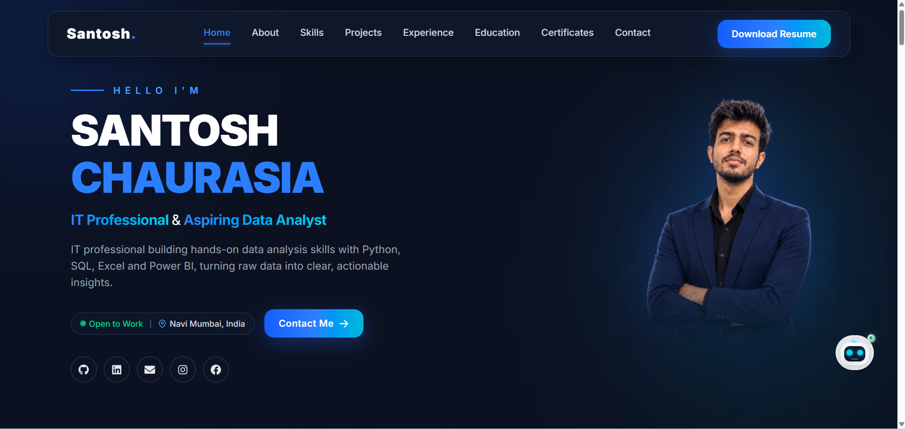
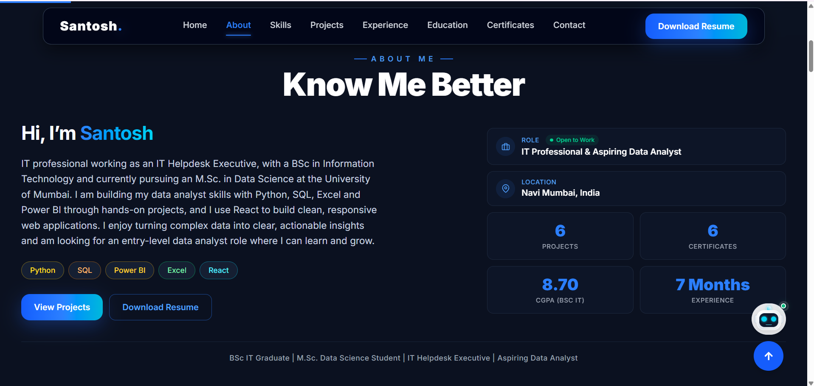
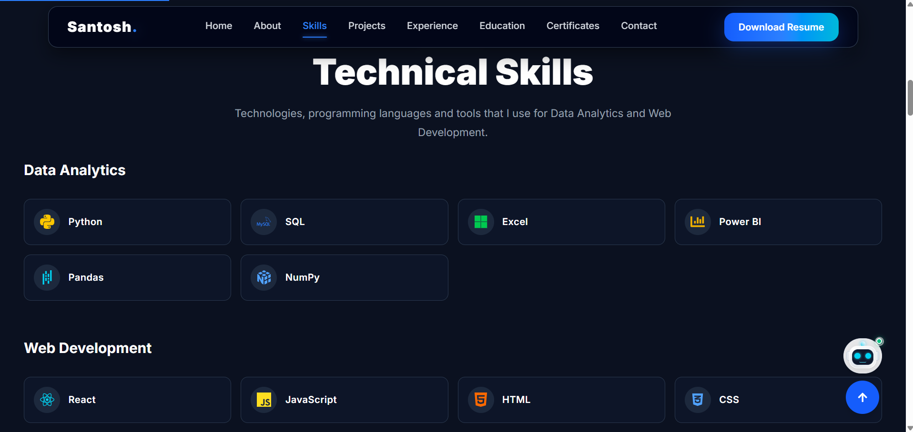
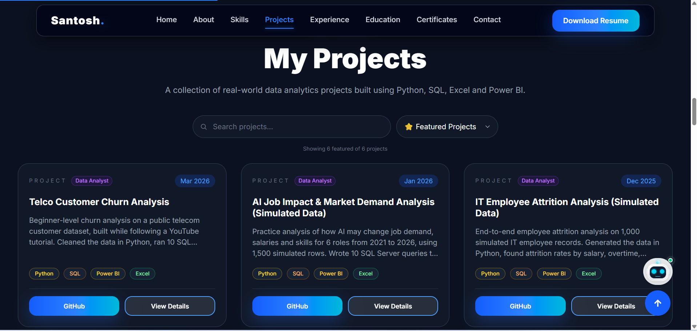
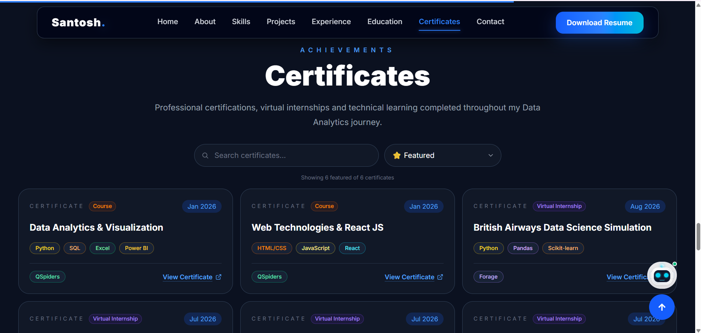
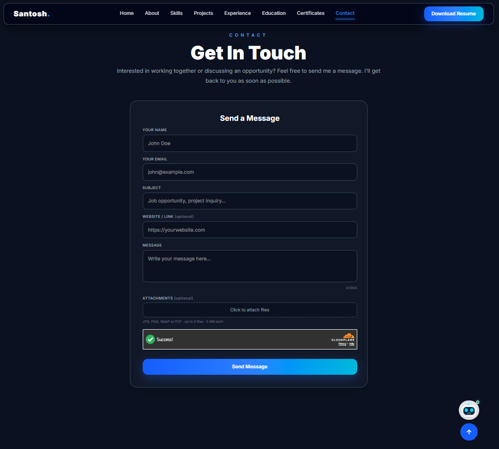
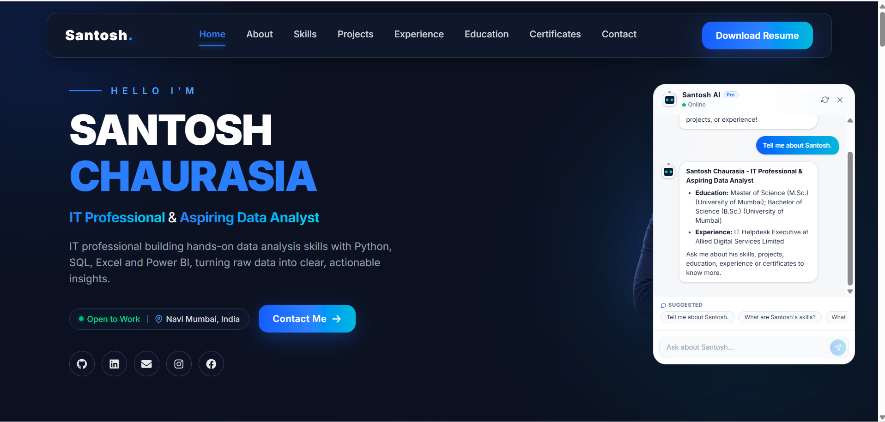
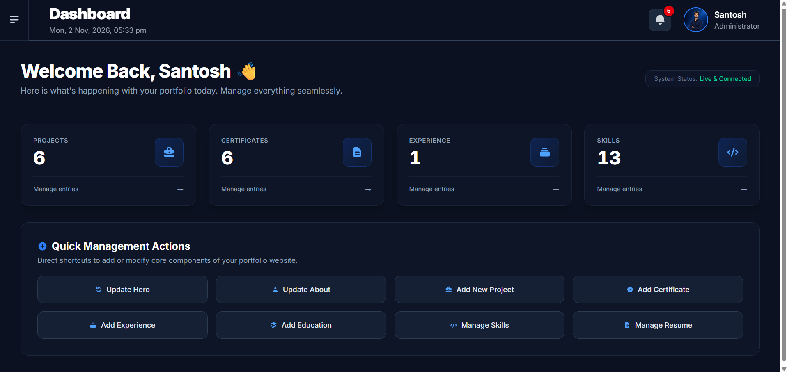

# AI-Powered Portfolio Management System

This is my personal portfolio website with an admin panel and an AI chatbot. I built it myself with React and Firebase. I can add or change everything on the website (projects, certificates, skills, resume and more) from my admin panel, without touching the code.

**Live website:** [santoshchaurasia.vercel.app](https://santoshchaurasia.vercel.app)

**Documentation:** [Project documentation (PDF)](docs/AI-Powered-Portfolio-Management-System-Documentation.pdf)

> The source code of this project is private, because the admin panel and the login security are part of it. This repository only has the project details and screenshots.

---

## Why I made this

I am a BSc IT graduate and I am doing my M.Sc. in Data Science. I wanted one place where recruiters can see my skills, projects and certificates. I also did not want to edit the code every time I add a new project. So I built a small management system for my own portfolio.

I call it "AI-Powered" because the website has a chatbot, Santosh AI, that answers questions about me.

---

## What is inside

The project has three parts:

1. **Portfolio website** - the public side that visitors see
2. **Admin panel** - the private side where I manage all the content
3. **Santosh AI chatbot** - a chatbot that answers questions about me

---

## Features

### Portfolio website

- Sections: Home, About, Skills, Projects, Experience, Education, Certificates and Contact
- All content comes from Firebase, so when I update something in the admin panel it changes on the website
- Home page shows my "Open to Work" status and location. I can turn the status on or off from the admin panel
- Projects section has search, a Featured / All filter and tags for each project
- "View Details" popup for each project shows the result, key highlights, tech stack and buttons for GitHub, Dashboard, Deck (PDF) and PPT download
- Certificates section has search, a featured filter and a "View Certificate" link
- Resume download button
- Works on mobile, tablet and laptop screens. I tested it on 7 screen sizes

### Admin panel

- Login with username or email and password, then a code from an authenticator app
- Dashboard with the number of projects, certificates, experience and skills, and quick buttons to add or update things
- Add, edit and delete projects, certificates, experience, education and skills
- Update Hero and About sections and upload my resume
- Image crop tool for the Hero photo
- Upload a dashboard image, a deck PDF and a PPT file for each project
- Star button to mark a project or certificate as Featured
- Messages page with Inbox and Spam, Pending / Replied status, "mark as unread" and delete
- Security Alerts page that shows wrong login attempts, with block and unblock IP buttons
- Notification bell for new messages and alerts
- When I replace or delete a file, the old file is also removed from Cloudinary

### Santosh AI chatbot

- Answers questions about my skills, projects, education, experience, certificates, contact details and resume
- For questions about a project, skill or certificate, the answer comes straight from my Firebase data
- For other questions about me, it uses an AI model. It tries Gemini first, and if that fails it tries Groq, Mistral and OpenRouter
- Each visitor can ask 15 AI questions per day. Simple data questions do not count in this limit
- It only answers questions about me. For other topics it says so politely
- Popular answers are saved for some time, so the replies come faster

### Contact form

- Fields: name, email, subject, website link (optional), message (up to 1000 characters) and up to 3 attachments (JPG, PNG, WebP or PDF, 5 MB each)
- Cloudflare Turnstile is used to stop bots
- Spam messages go to a separate Spam folder, they are not lost
- The same message from the same email within 24 hours is blocked, and there is a daily limit per email
- Very short or junk messages like "abcd" are rejected
- The visitor gets a clear message for success and for each error
- I get an email when a real message comes

---

## Tech stack

| Part | Technology |
|------|------------|
| Frontend | React.js, Vite, Tailwind CSS, Framer Motion, React Icons |
| Database and login | Firebase Firestore, Firebase Authentication |
| File storage | Cloudinary |
| Backend functions | Vercel serverless functions, Firebase Admin |
| Email | Resend |
| Bot protection | Cloudflare Turnstile |
| AI models | Gemini API, with Groq, Mistral and OpenRouter as backup |
| Hosting | Vercel |

---

## Screenshots

**Home**

**About**

**Skills**

**Projects**

**Certificates**

**Contact form**

**Santosh AI chatbot**

**Admin dashboard**

---

## How it works

1. All the portfolio content is saved in Firebase Firestore.
2. The website reads this content and shows it to the visitor.
3. I log in to the admin panel and add or change the content. Files like images, PDF and PPT are uploaded to Cloudinary.
4. The chatbot, the contact form and the admin security run on Vercel serverless functions, so the secret keys are never inside the website code.

---

## Problems I faced

- **Popup on small screens:** the project popup was getting cut on small phones, so I fixed the layout so only the middle part scrolls.
- **Spam in the contact form:** I added Turnstile, a spam folder and message limits.
- **AI quota:** the free Gemini quota can finish, so I added backup models and a daily limit per visitor.
- **Admin safety:** I added a second login step and a block after wrong attempts.
- **Old files in Cloudinary:** files were left behind after replacing them, so now the old file is deleted automatically.

---

## What I learned

- Building a full React app with Firebase and Tailwind CSS
- Writing Firestore rules and using serverless functions
- Uploading and deleting files with Cloudinary
- Making a layout responsive on many screen sizes
- Using AI models in a real project and handling their limits

---

## Future plans

- Add light animations on more sections
- Improve SEO so the website shows up on Google

---

## Contact

**Santosh Chaurasia**

- Email: amsantoshchaurasia@gmail.com
- LinkedIn: [linkedin.com/in/santoshchaurasia05](https://www.linkedin.com/in/santoshchaurasia05)
- GitHub: [github.com/santosh-chaurasia](https://github.com/santosh-chaurasia)
- Portfolio: [santoshchaurasia.vercel.app](https://santoshchaurasia.vercel.app)
